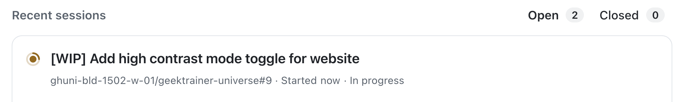

前の演習では、Copilot cloud agent にユーザー体験の改善と機能追加に関する 3 つの作業を依頼しました。cloud agent は非同期かつ自律的に動作しますが、作業を監視することも重要です。

cloud agent に割り当てたタスクを管理する方法はいくつかあります。[GitHub.com の agents ページ][agents-page]では、オープンなプルリクエスト (PR) があるエージェントタスクを確認できます。実行内容を調べ、進行中のセッションに追加の指示を送ることもできます。

この演習では、次のことを行います。

- agents ページで cloud agent のタスクを監視します。
- 進行中のセッションに指示を送り、機能を追加で依頼します。

## シナリオ

チームはハイコントラストモードの作業中に、ライトモードも追加するよい機会だと気付きました。サイトのスタイル更新と切り替え機能を作成中なので、ハイコントラストに加えてライトモードも実装するようエージェントに指示します。

## Copilot cloud agent のタスクを確認する

Copilot cloud agent に割り当てたすべてのタスクの現在の状況を確認します。

1. [Copilot agents ページ](https://github.com/copilot/agents)に移動します。
2. メインペインと左ペインのタスクリストを確認します。コードのドキュメント追加、ゲームを変更する API の生成、Web サイトへのハイコントラストモードの追加など、Copilot に割り当てたタスクが表示されます。
3. 実行中のタスクを選択し、Copilot が行った作業を確認します。リポジトリのチェックアウト、作業環境の作成、MCP サーバーの設定、タスクを完了するための各種操作などが含まれます。

> [!NOTE]
> 表示される手順は Copilot の作業状況や採用した方法によって異なります。

4. 右側に表示されるプルリクエスト (PR) ペインを確認します。PR と変更ファイルを確認して、作業を監視できます。

## cloud agent に追加の指示を送る

進行中のタスクを確認したので、ハイコントラストモードの作業にライトモードのトグルも含めるよう依頼します。

1. ハイコントラストモードを追加するセッションを選択します。表示されるタイトルは Copilot が付けた名前や作業状況によって異なります。

    

2. Copilot がセットアップを終えて作業を開始したことが分かるまで、数分間セッションを確認します。
3. **Steer active session while Copilot is working** ダイアログに次のプロンプトを入力します。

    ```plaintext
    While we are working on a high contrast mode, let's also add a light mode. There should be a switch for this mode as well where users can select their desired display mode.
    ```

    

4. <kbd>Enter</kbd> を押してプロンプトを送信します。
5. Copilot がプロンプトを受け取り、作業に追加する様子を確認します。

## Copilot の作業を待つ

Copilot は更新されたタスクに取り組みます。メッセージを送信した時点で進行中だった処理を終えてから、新しい依頼を作業に取り込みます。

今回も数分かかるため、これまでに学んだ内容を振り返りましょう。

## まとめと次のステップ

GitHub Copilot cloud agent タスクの監視とガイドに使う中心的な場所である Copilot agents ページを確認しました。ここでは、進行中および完了したタスクを追跡し、実行された作業を確認し、セッションの進行中にタスクの方向を変更したり、追加の指示を与えたりできます。

この演習では、次のことを行いました。

- agents ページを使って cloud agent のタスクを監視しました。
- 進行中のセッションに指示を送り、機能の追加を依頼しました。

Copilot がアクセシビリティ機能を完成させている間に、[Copilot が作成したプルリクエストを反復して改善][next-lesson]します。

## リソース

- [Copilot agents ページ][agents-page]
- [カスタムエージェントについて][custom-agents]

---

| [← 前のレッスン: カスタムエージェント][previous-lesson] | [次のレッスン: Copilot の作業を反復して改善する →][next-lesson] |
|:--|--:|

[previous-lesson]: ../3-custom-agents/
[next-lesson]: ../5-iterating/
[agents-page]: https://github.blog/changelog/2025-07-03-agents-page-for-copilot-coding-agent-in-public-preview
[custom-agents]: https://docs.github.com/copilot/concepts/agents/cloud-agent/about-custom-agents
